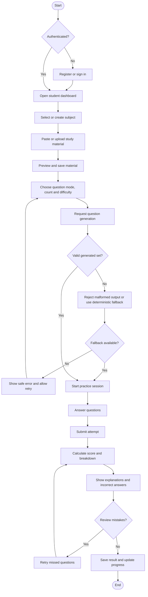

# Day 2 — Learner activity diagram

## Key validation points
- Material must belong to the signed-in student.
- Question count and mode must be within supported limits.
- Generated questions must pass schema and answer validation before a test can use them.
- A failed AI request must not expose secrets or leave a partially created test.
