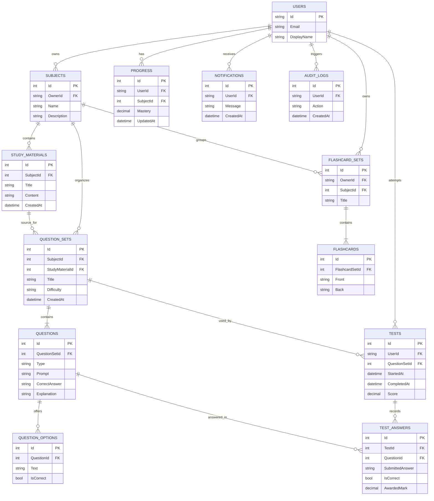

# Day 2 — Initial ERD

This is the logical MVP data blueprint. It is not yet an EF Core migration; entities and constraints will be implemented in later milestones.

## Notes
- `USERS` is intended to be backed by ASP.NET Core Identity; its key type and profile fields will be finalized with the Day 4 authentication design.
- Question options are used for multiple-choice questions; other question types can have no options.
- Ownership and authorization constraints must be enforced in application queries and API policies, not only by hiding UI elements.
- The schema may be refined when concrete domain entities and migrations are implemented.
