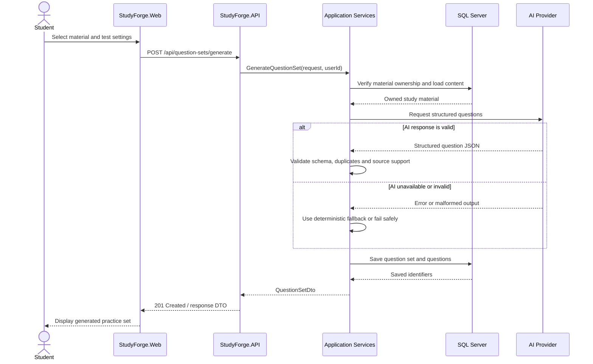

# Day 2 — Question-generation sequence diagram

## Design rules
- The browser never calls the AI provider directly.
- The API derives the authenticated user identity from the validated authentication context, not from a client-supplied owner ID.
- AI output is untrusted until server-side validation succeeds.
