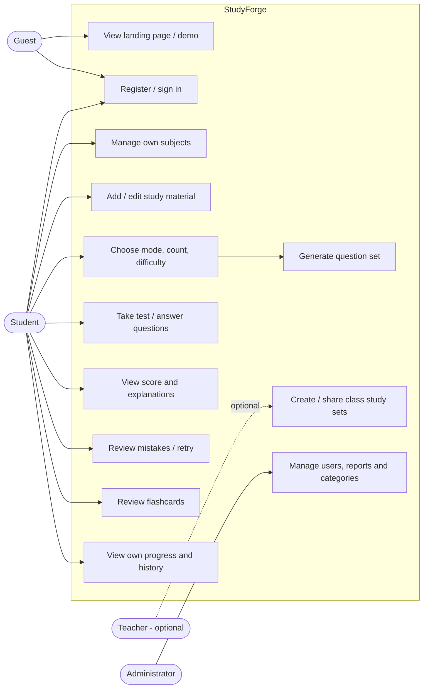

# Day 2 — Use-case diagram

The diagram captures the MVP actors and their principal interactions. Teacher/class functionality is marked optional and is not part of the initial MVP.

## Access boundary
Students can access only their own private subjects, materials, tests, answers, and progress. Teacher sharing is an explicit later feature. Administrative functions require an administrator role.
